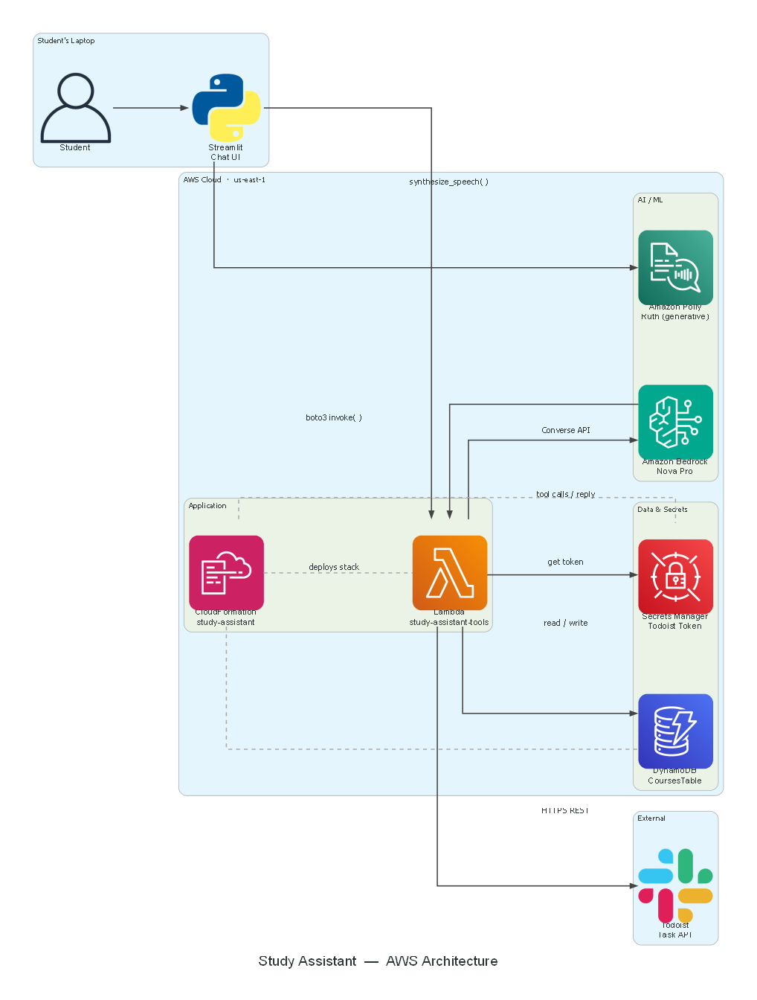

# Study Assistant

A personal AI study assistant built on Amazon Bedrock (Nova + the Converse API tool loop), AWS Lambda, DynamoDB and Todoist. Chat with it to save your courses, check what grade you need, and manage your real Todoist to-do list.



More detail: [docs/architecture.md](docs/architecture.md).

## Prerequisites
- AWS account, AWS CLI configured (`aws configure`), Bedrock access to Amazon Nova Pro in your region, and an IAM user allowed to call Bedrock and invoke Lambda (see [docs/iam-policy.json](docs/iam-policy.json))
- Python 3.10+
- A free Todoist account and API token (Todoist: Settings -> Integrations -> Developer)

## Setup
All commands work the same in PowerShell, macOS and Linux unless shown otherwise.

```
pip install -r requirements.txt
python scripts/check_setup.py
```
Fix anything marked ❌ before continuing.

## Build it
| Step | Command | What it does |
|---|---|---|
| 1 | `python scripts/deploy_stack.py` | Creates the table, secret, Lambda and role (asks for your Todoist token, input hidden) and pushes the Lambda code |
| 2 | `python scripts/deploy_lambda.py` | Re-pushes `lambda/` after you edit it |
| 3 | `streamlit run app/streamlit_app.py` | Opens the chat app. The agent loop runs inside it |
| 4 | `python scripts/e2e_test.py` | Optional: runs a scripted conversation (costs a few cents) |
| 5 | `python scripts/cleanup.py` | **Deletes everything** so nothing keeps costing money |

> **Why no Bedrock Agent?** AWS closed Bedrock Agents Classic to accounts with no recent agent usage (July 2026), so `CreateAgent` fails on new accounts. We run the same reason-act-observe loop ourselves with the Converse API instead; see `ask_agent()` in `app/agent_client.py`.

Try: *"My courses are OS (3 credits: quizzes 15, assignments 15, midterm 30, final 40)."* Then record marks, ask *"What do I need in the OS final to get an A-?"*, and *"Add my DB assignment due next Friday, high priority."* Turn on **Show agent reasoning** to watch the agent pick tools. Answers stream in word by word. Turn on **Speak replies (Polly)** to hear them: each sentence is sent to Amazon Polly as soon as it is written (default voice Ruth, `generative` engine; set `"polly_engine": "neural"` in `config.json` for a faster start).

## Troubleshooting
| Problem | Fix |
|---|---|
| `config.json not found` / tools not deployed | Run step 1 above |
| `No AWS credentials found` | `aws configure` |
| Access denied / model access | Bedrock console -> Model access -> enable the model in your region |
| Throttling | Wait a few seconds and retry |
| "Your Todoist token looks invalid" | Re-run `python scripts/deploy_stack.py` and paste a fresh token |
| Region mismatch | Make `config.json` and `aws configure get region` agree |
| Changed Lambda code but nothing happens | `python scripts/deploy_lambda.py` |
| Changed agent instructions or `functions.json` | Nothing to deploy: just restart/refresh the app |
| `lambda:InvokeFunction` access denied | Your IAM user needs permission to invoke the Lambda (see `docs/iam-policy.json`) |

## Run the tests (no AWS needed)
```
pip install -r requirements-dev.txt
pytest
```

## Repository map
`lambda/` tool code, `agent/` agent definition, `app/` Streamlit UI, `infra/` CloudFormation, `scripts/` setup and tests, `starter/` generated workshop skeleton (`python scripts/make_starter.py`).

## Extend it yourself
`record_absence` and `daily_brief` are already coded in the Lambda; wire them into your own prompts. Next ideas: voice input (Transcribe), Google Calendar / Google Tasks via OAuth, deploying Streamlit, Bedrock Guardrails, agent long-term memory.
