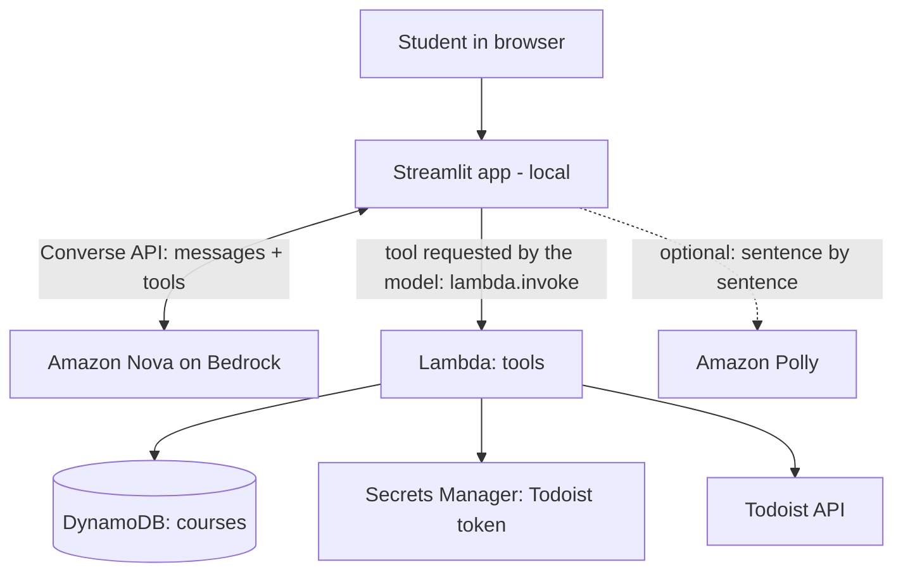

# Architecture

## The ReAct loop
1. The student sends a message; `ask_agent()` sends it to the model plus the conversation so far (the app keeps the history; the model remembers nothing).
2. **Reason**: the model decides what it needs ("I need the OS marks").
3. **Act**: it replies with a `toolUse` request: a function name and parameters, based on the descriptions in `agent/functions.json`.
4. The app invokes our Lambda with a Bedrock-Agents-style event; the Lambda runs the Python function and returns text.
5. **Observe**: the model reads the result and either calls another tool or writes the final answer.

That is why good function and parameter descriptions matter: they are the only thing the model knows about our tools.

## Streaming and voice
`stream_agent()` uses `converse_stream`, so words reach the page while the model is still writing. With speech on, `app/voice.py` cuts the text into sentences, has Polly turn each into MP3 in background threads, and the browser plays the clips in order.

## Who creates what
| Piece | Created by |
|---|---|
| DynamoDB table, secret, Lambda, Lambda role, log group | `scripts/deploy_stack.py` (CloudFormation) |
| Lambda code | `scripts/deploy_lambda.py` |
| The agent loop | `app/agent_client.py` (plain Python, runs in the app) |
| Everything removed | `scripts/cleanup.py` |

## Security notes (teaching points)
- The app runs with *your* IAM credentials, so your user needs `lambda:InvokeFunction` on this one function and permission to call Bedrock.
- The Lambda role can only touch this table, this secret and its own log group.
- The Todoist token lives in Secrets Manager and is never logged or returned.
